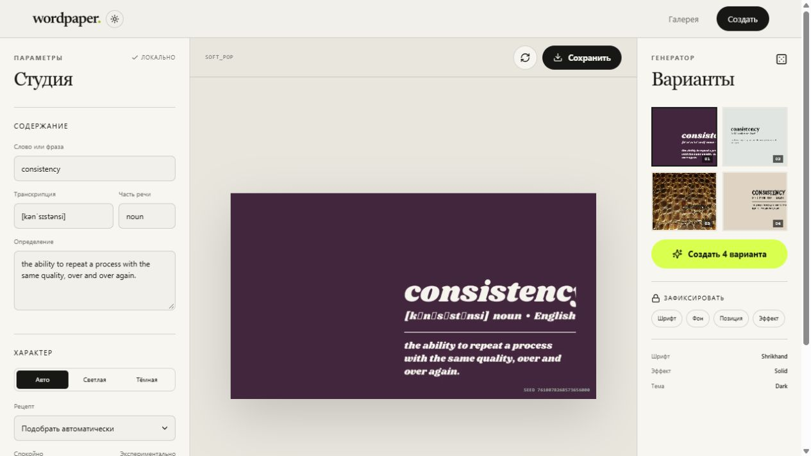

# Wordpaper

Wordpaper turns a word, its transcription and definition into reproducible
typographic wallpapers. The repository contains the rendering library, a
FastAPI service and a React studio.



## What is included

- `src/wordpaper_core` — domain model and Pillow rendering backend;
- `apps/backend` — generation, projects, versions, gallery, renders and downloads;
- `apps/frontend` — gallery, controlled-random studio and export screen;
- `tests` — rendering-library tests;
- `apps/backend/tests` — deterministic generation and API rendering tests;
- bundled fonts and textures with their license/source information.

The saved JSON specification is the source of truth. Preview and export files
are artifacts that can be regenerated from the specification, seed and renderer
version. An export always rerenders for its target resolution instead of
stretching a preview.

## Local development

Python 3.13 and Node.js 22 are recommended.

Create the environment and install the renderer plus API dependencies:

```powershell
python -m venv .venv
.\.venv\Scripts\python.exe -m pip install -r apps\backend\requirements.txt
```

Start the API from the repository root:

```powershell
$env:PYTHONPATH = "apps/backend"
.\.venv\Scripts\python.exe -m uvicorn wordpaper_api.main:app --reload --port 8000
```

In a second terminal, start the web app:

```powershell
cd apps\frontend
npm install
npm run dev
```

Open `http://127.0.0.1:5173`. The local default uses SQLite and stores rendered
files under `.data/`; no external services are required.

## Docker

The complete PostgreSQL, API and web stack is also available through Compose:

```powershell
docker compose up --build
```

Open `http://localhost:8080`. PostgreSQL data and rendered files live in named
Docker volumes.

## Configuration

Copy `.env.example` when running against your own PostgreSQL instance.

| Variable | Purpose | Local default |
| --- | --- | --- |
| `WORDPAPER_DATABASE_URL` | SQLAlchemy database URL | SQLite in `.data` |
| `WORDPAPER_STORAGE_ROOT` | Render and preview directory | `.data/storage` |
| `WORDPAPER_FRONTEND_ORIGIN` | Allowed browser origin | `http://localhost:5173` |
| `WORDPAPER_COOKIE_SECURE` | Secure anonymous-session cookie | `false` |

## Main API routes

- `GET /api/health` — service and renderer status;
- `GET /api/v1/meta` — fonts, textures, recipes, anchors and resolutions;
- `GET /api/v1/words/{word}` — automatic English/Russian dictionary lookup;
- `POST /api/v1/generations` — four deterministic variants;
- `POST /api/v1/walls` — save a project and its first immutable version;
- `GET /api/v1/gallery` — filterable public gallery;
- `GET/PATCH /api/v1/walls/{wall_id}` — read or revise a project;
- `POST /api/v1/walls/{wall_id}/renders` — resolution-specific export;
- `POST /api/v1/walls/{wall_id}/fork` — create an editable copy;
- `GET /api/v1/renders/{render_id}/download` — download and count an export.

Interactive OpenAPI documentation is at `http://127.0.0.1:8000/docs`.

Dictionary definitions are loaded from Free Dictionary API for English and
Russian Wiktionary for Russian. Their source and license are stored with the
wallpaper recipe, shown on saved-wall pages and embedded in exported image
metadata.

## Tests and production build

```powershell
.\.venv\Scripts\python.exe -m unittest discover -s tests -v
$env:PYTHONPATH = "apps/backend"
.\.venv\Scripts\python.exe -m unittest discover -s apps/backend/tests -v
cd apps\frontend
npm run build
```

## Core library usage

Application code can use the renderer without FastAPI or a database:

```python
from wordpaper_core import PillowRenderer, RenderSize

artifact = PillowRenderer.create_default().render(
    wallpaper,
    RenderSize(width=1920, height=1080),
)
```

See `examples/generate_wallpaper.py` for a complete liquid-glass example.

---

Special thanks to Codex/ChatGPT.
